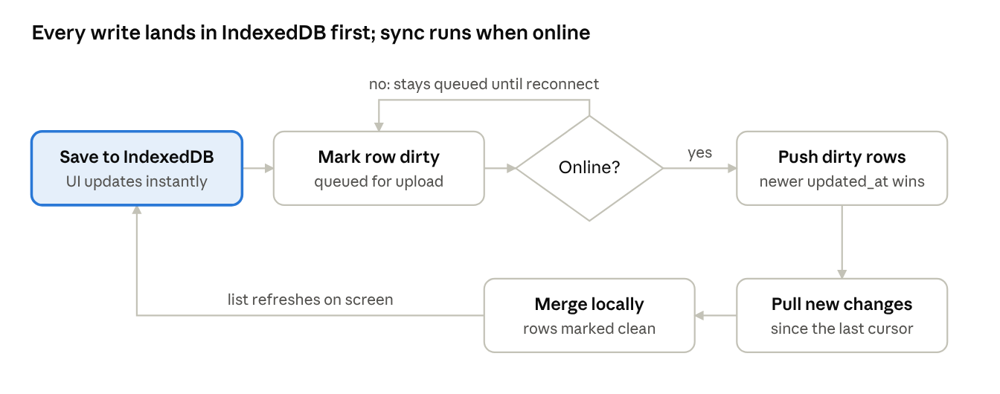

# Offline-First Budget Tracker — Build Plan (PERN)

Updated: 2026-10-12

## Overview

One React app, installed as a **PWA** (Progressive Web App) on Android and Windows, saves every change in the browser's local database (IndexedDB) first. A sync service you write yourself sends those changes to an Express + PostgreSQL server whenever the device is online.

"Downloadable" here means installable: Chrome/Edge on Windows shows an **Install app** button, and Chrome on Android adds it to the home screen like a normal app. It opens in its own window, without the browser bar, and works offline.

| Layer | Choice | Why |
| --- | --- | --- |
| **P**ostgreSQL 16 (Docker) | Server database | Master copy of every user's data |
| **E**xpress (Node 24) | API | Login + two sync endpoints (`push`, `pull`) |
| **R**eact (Vite) | UI | One app for phone and desktop (responsive) |
| **N**ode 24 | Runtime | Runs Express; `--env-file` replaces dotenv |
| Dexie (IndexedDB) | Local database in the browser | Makes the app work offline; `useLiveQuery` refreshes lists automatically |
| vite-plugin-pwa | Install + offline app shell | Service worker caches the app so it opens with no internet |
| bcryptjs + jsonwebtoken | Auth | Password hashing + JWT in an httpOnly cookie |
| Zod | Validation | Checks every row the server receives |
| Recharts | Charts | Pie, line and bar charts |
| Vitest + Supertest | Tests | Money math, merge rule, sync endpoints |

**Golden rules** (apply from Phase 1; they are painful to change later):

1. Money is an integer in centavos everywhere (₱150.75 → 15075): `bigint` in Postgres, `number` in JS. Convert only for display.
2. IDs are UUIDs made on the device with `crypto.randomUUID()`, never `serial`.
3. Nothing is hard-deleted. Set `deleted_at` so the delete itself can sync.
4. Every local write goes through `repo.js` (`save` / `softDelete`), which sets `updated_at` and `dirty = 1`. Components never write to Dexie directly.
5. Balances and totals are computed, never stored, so there is nothing to conflict.
6. `txn_date` is plain `YYYY-MM-DD` (local date). Timestamps are ISO strings in UTC.
7. Column names are the same snake_case everywhere: Postgres, IndexedDB and JSON. No mapping layer.
8. The server takes `user_id` from the JWT only, never from the request body.

## Folder structure

```text
budget-tracker/
  docker-compose.yml      # Postgres for dev; full stack in Phase 10
  server/
    src/
      index.js            # Express app, cookie-parser, routes, error handler
      db.js               # pg Pool + type parsers
      auth.js             # register / login / logout / me + requireAuth
      sync.js             # POST /api/sync/push, GET /api/sync/pull
    migrations/001_init.sql
    test/
  client/
    src/
      db.js               # Dexie schema
      repo.js             # save() / softDelete()
      sync.js             # sync service
      money.js  dates.js
      pages/  components/
    vite.config.js        # /api proxy to :3000 + PWA plugin
```

Same-origin design: in dev, Vite proxies `/api` to Express; in production, Express serves the built React app. No CORS package needed.

## Phase 0 — Setup

**Goal:** Postgres running, Express answering, React page loading.

1. Install Node 24, Docker Desktop, Git, VS Code. Check: `node -v`, `docker -v`, `git -v`.
2. `docker-compose.yml` with one `postgres:16` service, a named volume, port 5433 on the host (5432 is taken by a local Postgres), password from `.env`.
3. Server: `npm init -y`, set `"type": "module"`, install `express pg zod bcryptjs jsonwebtoken cookie-parser`, dev: `vitest supertest`. Add `GET /api/health` → `{ ok: true }`. Run with `node --env-file=.env --watch src/index.js`.
4. Client: `npm create vite@latest client -- --template react`, install `react-router-dom dexie dexie-react-hooks recharts uuid`, dev: `vite-plugin-pwa vitest`. Add the `/api` proxy in `vite.config.js`.
5. Git repo with `.gitignore` covering `node_modules`, `.env`, `dist`.

**Done when:** `docker compose up -d` runs Postgres, `http://localhost:3000/api/health` returns `{ ok: true }`, and the Vite page loads at `http://localhost:5173`.

## Phase 1 — Database schema

**Goal:** all server tables exist, with the sync columns built in from day one.

| Table | Holds | Notes |
| --- | --- | --- |
| users | email, password hash | Server only |
| accounts | Cash, GCash, BDO… + opening balance | Balance is computed |
| categories | Food, Transport, Salary… typed income or expense | Icon + color |
| transactions | Every income, expense and transfer | The core table |
| budgets | Limit per category per month | One row per category + month |
| recurring_rules | Rent, subscriptions, salary | Frequency + `next_run_date` |

Every synced table has `id uuid`, `user_id`, `created_at`, `updated_at`, `deleted_at` and `server_updated_at`.

```sql
create table users (
  id            uuid primary key default gen_random_uuid(),
  email         text not null unique,
  password_hash text not null,
  created_at    timestamptz not null default now()
);

create table transactions (
  id                uuid primary key,                 -- made on the device
  user_id           uuid not null references users(id),
  account_id        uuid not null,
  category_id       uuid,
  to_account_id     uuid,                             -- transfers only
  type              text not null check (type in ('income','expense','transfer')),
  amount_cents      bigint not null check (amount_cents > 0),
  txn_date          date not null,
  note              text,
  created_at        timestamptz not null,
  updated_at        timestamptz not null,             -- set by the device, decides conflicts
  deleted_at        timestamptz,
  server_updated_at timestamptz not null default now() -- set by the server, pull cursor
);
create index on transactions (user_id, server_updated_at);
```

- `amount_cents bigint` keeps money exact; `check` rejects zero and negatives even if the app has a bug.
- `updated_at` comes from the device and decides who wins a conflict; `server_updated_at` comes from the server and drives the pull.
- The `(user_id, server_updated_at)` index makes "give me everything new since X" fast.

Steps:

1. Write `migrations/001_init.sql` for all six tables, plus a 15-line `migrate.js` that runs `.sql` files in order and records them in a `migrations` table.
2. In `db.js`, make `pg` return dates and bigints the way the app expects:
    - `types.setTypeParser(1082, v => v)`: a `date` stays `'2026-10-12'`; otherwise pg turns it into a JS Date at midnight and it can shift a day.
    - `types.setTypeParser(20, Number)`: a `bigint` becomes a number instead of a string.

**Done when:** `\dt` in psql shows the tables, and inserting `amount_cents = -5` fails with a check-constraint error.

## Phase 2 — Auth API

**Goal:** register, log in, and protect routes.

1. `POST /api/auth/register`: Zod-validate email + password (min 8), hash with bcryptjs, insert.
2. `POST /api/auth/login`: check the hash, sign a JWT `{ sub: user.id }` (30 days), and set it as a cookie: `httpOnly`, `sameSite: 'strict'`, `secure` in production.
3. `POST /api/auth/logout` clears the cookie. `GET /api/auth/me` returns `{ id, email }`.
4. `requireAuth` middleware: verify the cookie and set `req.userId`. Return 401 if it's missing or invalid.
5. Central error handler: Zod errors → 400 with the field messages; everything else → 500 with no stack trace.

**Done when:** in a REST client, register → login → `/api/auth/me` works, and `/api/auth/me` without the cookie returns 401.

## Phase 3 — Local database + transactions (offline only)

**Goal:** add, list, edit and delete expenses in the browser with the server turned off.

```js
// client/src/db.js
import Dexie from 'dexie';
export const db = new Dexie('budget');
db.version(1).stores({
  accounts:        'id, dirty',
  categories:      'id, dirty',
  transactions:    'id, txn_date, account_id, category_id, dirty',
  budgets:         'id, [category_id+month], dirty',
  recurring_rules: 'id, next_run_date, dirty',
  meta:            'key',              // sync cursor, cached user
});
```

- Only indexed fields are listed; Dexie stores every other field anyway.
- `dirty` is `1` or `0`, not `true`/`false`, because IndexedDB cannot index booleans.

```js
// client/src/repo.js
import { db } from './db';
const now = () => new Date().toISOString();

export const save = (table, row) => {
  const t = now();
  return db[table].put({ created_at: t, ...row, id: row.id ?? crypto.randomUUID(), updated_at: t, dirty: 1 });
};
export const softDelete = (table, id) =>
  db[table].update(id, { deleted_at: now(), updated_at: now(), dirty: 1 });
```

- Every write sets `updated_at` and `dirty = 1`, so the sync service knows what to send.
- `created_at` is kept on edits because `...row` comes after it.

Steps:

1. `money.js`: `toCents('150.75') → 15075` (reject more than 2 decimals and negatives), `formatPeso(15075) → '₱150.75'` using `Intl.NumberFormat('en-PH', { style: 'currency', currency: 'PHP' })`.
2. `dates.js`: `today()` → `new Date().toLocaleDateString('en-CA')` returns the local `YYYY-MM-DD`.
3. Transactions page: month switcher, list grouped by day with `useLiveQuery`, month income / expense / net at the top, hiding rows with `deleted_at`.
4. Add/Edit form: amount, type, category, account, date (default today), note. Delete shows an **Undo** toast that clears `deleted_at`.
5. Responsive layout: bottom nav under 600 px, sidebar above. Plain CSS (flex/grid + one media query).

**Done when:** with the server stopped, you add 10 expenses, reload the page, and they are all still there.

## Phase 4 — Accounts, categories and transfers

**Goal:** money lives in named wallets, and moving money between them is not counted as spending.

1. Accounts page: add/edit/archive Cash, GCash, BDO… with an opening balance.
2. Categories page: seed defaults on first run (Food, Transport, Bills, Shopping, Salary, Other).
3. Transfer: one row with `type = 'transfer'`, `account_id` = from, `to_account_id` = to, no category.
4. `balances()` helper: opening + income − expense − transfers out + transfers in, skipping deleted rows.
5. Income/expense totals skip transfers.

**Done when:** a ₱1,000 GCash → Cash transfer changes both balances and leaves the month's expenses unchanged.

## Phase 5 — PWA: installable + offline

**Goal:** the app installs like a real app and opens with no internet.

1. Add `VitePWA({ registerType: 'autoUpdate', manifest: {...} })` to `vite.config.js`: name, short name, theme color, `display: 'standalone'`, 192 px and 512 px icons.
2. The service worker precaches the built app (HTML, JS, CSS, icons), so it loads offline.
3. Show a small "Update available — reload" toast when a new version is deployed.
4. Test on Windows: `npm run build && npm run preview`, open in Chrome/Edge, click **Install app**, turn Wi-Fi off, open the app from the Start menu.

Phones only allow installing over **HTTPS** (`localhost` is the exception), so the phone test happens in Phase 10.

**Done when:** the installed Windows app opens and works with Wi-Fi off.

## Phase 6 — Sync engine

**Goal:** changes made offline on one device appear on another once both are online, and nothing is lost.



Server, `POST /api/sync/push` with body `{ table, rows }` (max 100 rows):

```sql
insert into transactions (id, user_id, account_id, /* ...all columns */ updated_at, deleted_at, server_updated_at)
values ($1, $2, $3, /* ... */ now())
on conflict (id) do update set
  account_id = excluded.account_id, /* ...all columns */
  updated_at = excluded.updated_at,
  deleted_at = excluded.deleted_at,
  server_updated_at = now()
where transactions.user_id = excluded.user_id       -- never touch another user's row
  and transactions.updated_at < excluded.updated_at; -- last write wins
```

- `on conflict ... where` is the whole conflict rule: an older edit is silently skipped.
- The `user_id` check stops one user from overwriting another user's row by guessing its id.
- `user_id` is `req.userId` from the JWT. The table name and column list come from a fixed whitelist in `sync.js`, never from the request.

Server, `GET /api/sync/pull?since=<ISO>`: every table's rows where `user_id = req.userId and server_updated_at > since - interval '5 seconds'`. The response is `{ rows: { accounts: [...], ... }, cursor }`, where `cursor` is the highest `server_updated_at` returned. The 5-second overlap catches slow commits; re-applying a row is harmless.

Client `sync()`:

1. Skip if a sync is already running or `navigator.onLine` is false.
2. **Push**, parents first (accounts, categories, budgets, recurring_rules, transactions): send `dirty = 1` rows without the `dirty` field, 100 at a time. After each batch, set `dirty = 0` only on rows whose `updated_at` hasn't changed since they were read, so an edit made during sync isn't lost.
3. **Pull** since the saved cursor. For each row: write it locally with `dirty = 0` unless the local copy is dirty **and** has a newer `updated_at`.
4. Save the new cursor in `meta`.
5. Runs on: app start, the `online` event, 2 s after any write (debounced), every 5 minutes, and a **Sync now** button.
6. Status icon: synced / syncing / offline / log in to sync.

Logging out deletes the local database (shared PCs), but first warns and blocks if any rows are still dirty.

**Done when:** in two browser profiles logged into the same account, with the server stopped, you add 3 expenses in one and edit an old one in the other; after the server starts, both show all changes with no duplicates.

## Phase 7 — Dashboard, budgets and charts

**Goal:** at a glance, see where this month's money went and how close each budget is to its limit.

1. Cards: total balance, this month's income, expenses and net.
2. Spending by category: Recharts pie.
3. Last 6 months of expenses: Recharts bar or line.
4. Budgets page: monthly limit per expense category with a progress bar. Under 80% normal, 80–100% warning, over 100% red with the amount over.
5. All numbers come from `reports.js` helpers that read Dexie and are covered by tests in Phase 9.

**Done when:** adding a ₱500 Food expense immediately moves the pie slice, the Food budget bar and the month total.

## Phase 8 — Recurring, export and settings

**Goal:** rent and subscriptions log themselves, and your data can leave the app.

1. Recurring rules: amount, category, account, frequency (daily / weekly / monthly), `next_run_date`.
2. On app start, create a transaction for every rule due today or earlier, then move `next_run_date` forward; loop until it is in the future, so a device left off for 3 months catches up.
    - The id is `uuidv5(rule.id + date, NAMESPACE)` from the `uuid` package, so two devices running the same rule offline make the same row, not a duplicate.
3. CSV export of a date range using a `Blob` + download link (no library). Start the file with `` so Excel shows ₱ correctly.
4. Settings: first day of the budget month, light/dark theme, **Sync now**, log out.

**Done when:** a monthly ₱15,000 rent rule due Feb 15 creates 3 entries (Feb, Mar, Apr) when the app is next opened on Apr 16, and the CSV opens correctly in Excel.

## Phase 9 — Testing

**Goal:** prove the money math and the sync rules before real data goes in.

Unit tests (Vitest):

- `money.js`: "150.75" → 15075, 15075 → "₱150.75", rejects "1.234" and "-5".
- Balances and reports: transfers move money but don't count as spending; deleted rows are ignored.
- Merge rule: remote newer overwrites; local dirty and newer is kept; pulled rows end clean.
- Recurring: catches up 3 missed months; the same rule on two devices gives the same ids.

API tests (Vitest + Supertest, against a separate test database):

- Push then pull returns the same row.
- An older `updated_at` does not overwrite a newer one.
- User B cannot read or overwrite user A's rows, even with the right id.
- Push/pull without a cookie returns 401.

Manual checklist:

- [ ] Both devices offline: add on each, reconnect both → lists match.
- [ ] Same expense edited on both while offline → the later edit wins on both.
- [ ] Delete on one → disappears on the other after sync.
- [ ] Close the tab mid-sync → next sync finishes with no duplicates.
- [ ] Fresh install + login → all history downloads.

**Done when:** all tests pass and every checklist item is ticked.

## Phase 10 — Deploy and install

**Goal:** the app runs on your server over HTTPS and is installed on your phone and PC.

1. Server `Dockerfile`: build the client, copy `client/dist` into the server image, and serve it with `express.static` plus a fallback to `index.html`.
2. `docker-compose.yml`: `db` (Postgres + volume) and `app` (Express on 3000). Secrets come from `.env` on the server, never from Git.
3. Deploy to a container or VM on your Proxmox server.
4. HTTPS (required for installing on a phone): Caddy in front with a domain, or a Cloudflare Tunnel if the server isn't reachable from the internet.
5. Set the cookie's `secure: true` in production.
6. Install: on Android, open the site in Chrome → **Install app**; on Windows, Chrome/Edge → **Install app**.
7. Back up the database with a nightly `pg_dump` cron job.

**Done when:** the app is installed on your phone and PC from your own HTTPS URL, and an expense added on the phone in airplane mode shows up on the PC after the phone reconnects.

## Progress checklist

- [ ] Phase 0 — Setup
- [ ] Phase 1 — Database schema
- [ ] Phase 2 — Auth API
- [ ] Phase 3 — Local database + transactions
- [ ] Phase 4 — Accounts, categories, transfers
- [ ] Phase 5 — PWA install + offline
- [ ] Phase 6 — Sync engine
- [ ] Phase 7 — Dashboard, budgets, charts
- [ ] Phase 8 — Recurring, export, settings
- [ ] Phase 9 — Testing
- [ ] Phase 10 — Deploy and install

After v1: a real Android APK by wrapping the same React build with Capacitor, receipt photos, shared household budgets, TypeScript migration.
